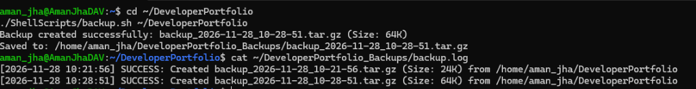
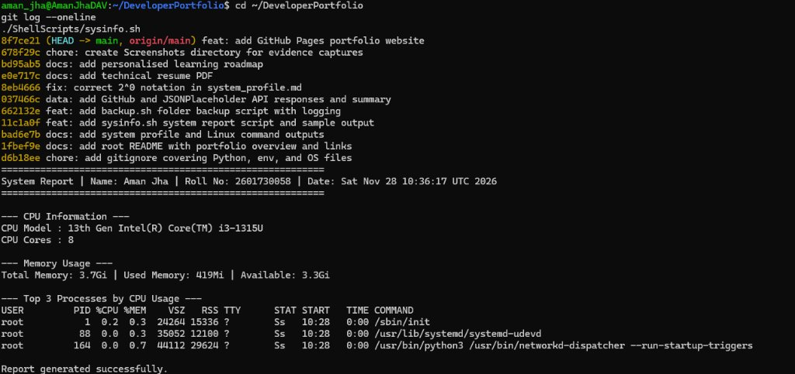
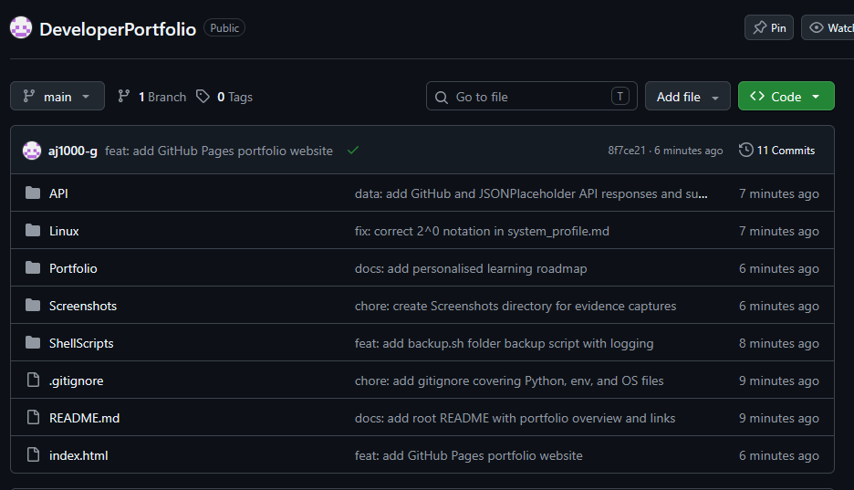
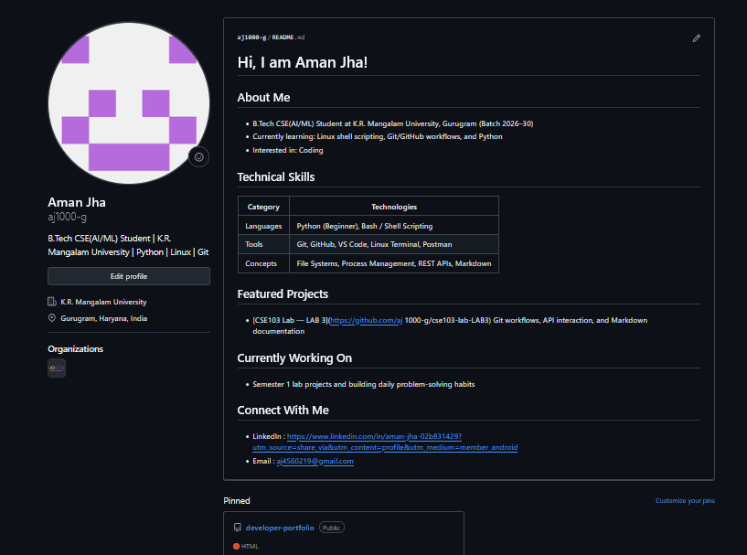

# DeveloperPortfolio — Capstone Project

**Student:** Aman Jha  
**Roll Number:** 2601730058  
**University:** K.R. Mangalam University, Gurugram  
**Batch:** 2026–2030 (B.Tech Computer Science and Engineering - AI & ML)  
**Specialisation Track:** AI / ML  

---

## Live Links & Profiles
- **Live Portfolio Website:** [https://aj1000-g.github.io/DeveloperPortfolio/](https://aj1000-g.github.io/DeveloperPortfolio/)
- **GitHub Profile:** [https://github.com/aj1000-g](https://github.com/aj1000-g)
- **LinkedIn Profile:** [https://www.linkedin.com/in/aman-jha-02b831429](https://www.linkedin.com/in/aman-jha-02b831429)
- **Repository:** [https://github.com/aj1000-g/DeveloperPortfolio](https://github.com/aj1000-g/DeveloperPortfolio)

---

## Project Structure & Deliverables

### 1. Linux Systems & Hardware Diagnostics (`Linux/`)
- [system_profile.md](Linux/system_profile.md): Workstation hardware & OS specification table and step-by-step binary number conversions.
- [commands_output.txt](Linux/commands_output.txt): Captured outputs of `ls -la ~`, `ps aux | head -10`, `df -h`, and `free -h`.

### 2. Shell Scripts & Automation (`ShellScripts/`)
- [sysinfo.sh](ShellScripts/sysinfo.sh): Automated system health report script (CPU, memory, top 3 processes).
- [sysinfo_output.txt](ShellScripts/sysinfo_output.txt): Sample execution output of `sysinfo.sh`.
- [backup.sh](ShellScripts/backup.sh): Folder backup script creating timestamped `.tar.gz` archives in `~/DeveloperPortfolio_Backups/` with logging.

### 3. GitHub Repository & API Interaction (`API/`)
- [github_profile.json](API/github_profile.json): Live profile response fetched from the GitHub REST API.
- [sample_posts.json](API/sample_posts.json): Sample posts JSON fetched from JSONPlaceholder.
- [api_summary.md](API/api_summary.md): Explanation of REST APIs, HTTP status codes (`200` and `404`), and `jq` filter usage.
- [fetch_api.py](API/fetch_api.py): Python script to fetch and parse GitHub profile data.

### 4. Developer Portfolio & Career Roadmap (`Portfolio/`)
- [resume.pdf](Portfolio/resume.pdf): One-page technical resume PDF.
- [learning_roadmap.md](Portfolio/learning_roadmap.md): Personalised semester-wise learning roadmap (AI / ML track).
- [index.html](index.html): Responsive GitHub Pages portfolio website at the repository root.

---

## Evidence & Verification Screenshots (`Screenshots/`)

### Automated Folder Backup Demo


### Terminal Verification (`git log --oneline` & `sysinfo.sh`)


### GitHub Repository (`DeveloperPortfolio`)


### GitHub Profile


### LinkedIn Profile


---

## Commit History Verification
Run the following command to view Conventional Commits history:
```bash
git log --oneline
```
